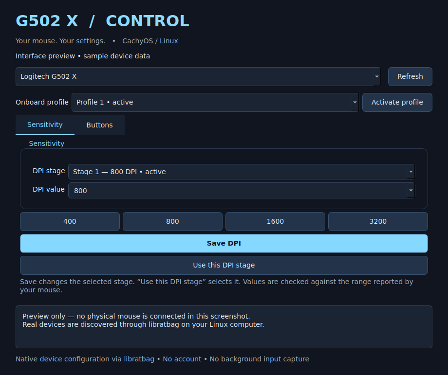

# G502 X Control

A native Python / Qt 6 desktop app for Logitech G502-family mice exposed by libratbag. Dark interface with ice-blue accents. Built for DPI and button configuration on KDE Wayland or X11.



*Interface preview using sample device data; this is not a hardware-test result.*

**Status: 0.1.0 preview.** Automated checks cover software behavior; physical
G502 X validation is still pending. This is an independent community app.

## Features

- Edit supported DPI values and select the active DPI stage.
- Change mouse-button actions and assign keyboard shortcuts.
- Select and activate onboard profiles.
- Protect the last left-click assignment and check driver write results.
- Install a native desktop launcher without a background input-capture service.

## Compatibility

| Platform / model | Status |
| --- | --- |
| CachyOS / Arch Linux | Target platform; packaged installer included |
| KDE Wayland / X11 | Native Qt interface; no X11-only input injection |
| G502 X wired | Requires recognition by installed libratbag; hardware testing pending |
| G502 X LIGHTSPEED / PLUS | Driver/kernel/connection dependent; hardware testing pending |
| Other G502 models | May appear through the family filter; not validated |
| Windows / macOS | Not supported |

## Install

Download **Code → Download ZIP**, extract it, and open a terminal inside the extracted project folder. Run:

```bash
bash install.sh
```

Launch **G502 X Control** from your application menu. The installer asks for sudo to install the official Arch/CachyOS packages `pyside6`, `python-dbus-next`, `python-evdev`, and `libratbag`, and starts ratbagd. The app itself runs as your ordinary user. No AUR helper, pip, account, or background key interception is needed.

If your package mirrors are out of date, update CachyOS normally with `sudo pacman -Syu` first; don't perform a partial system upgrade.

## Use

1. Select your mouse and onboard profile. Click **Activate profile** if necessary.
2. In **Sensitivity**, choose a DPI stage, type or select a supported DPI, then **Save DPI**. Choose **Use this DPI stage** to make it active. XY values are set together.
3. In **Buttons**, select a driver button index and a new action. Save the assignment. Keyboard shortcuts use Linux key names: `LEFTCTRL+C`, `LEFTALT+TAB`, `SPACE`, `F13`, `V`, etc. These are press/release shortcuts, not a held-key mode.
4. Click **Refresh** after changing profiles with the mouse, reconnecting it, or using another tool. The app does not poll continuously.

DPI, mouse button actions, DPI shift/cycling, profile cycling, scroll actions, and keyboard shortcuts are exposed where the driver advertises the action type. Individual special functions can still be rejected by the firmware; errors are shown instead of silently reporting success. The last left-click mapping is protected. Existing macros are preserved unless you explicitly replace their button assignment.

Settings are submitted through ratbagd's onboard configuration interface. The app monitors asynchronous write failures and checks driver readback. Reconnect the mouse to confirm persistence on your particular firmware. Avoid configuring the same mouse simultaneously in Piper, Solaar, or another utility.

## Detection / troubleshooting

```bash
ratbagctl list
sudo systemctl restart ratbagd
journalctl -u ratbagd -b --no-pager -n 80
```

If `ratbagctl list` cannot see the mouse, this app cannot configure it either. Update CachyOS/libratbag and reconnect. For G502 X LIGHTSPEED or PLUS, try a USB **data** cable; wireless support depends on your kernel, libratbag release and receiver. The app does not install guessed device definitions, modify HID permissions, or implement its own firmware protocol. An unsupported profile layout is a driver limitation, not something to fix by granting broad input-device access.

If a failed edit leaves pending settings in ratbagd, restart the service and Refresh before trying again. Driver-side edits and commits are not atomic; after an error inspect the refreshed state before proceeding. No automatic retry or factory reset is performed.

Button numbers are zero-based driver indexes, not printed Logitech G numbers. Use the current assignment to identify each control. The free-spin wheel latch is mechanical and isn't remappable. This version doesn't include G-Shift layers, timed macro editing, auto-switching game profiles or RGB.

## Run from source

After installing dependencies:

```bash
python3 app.py
QT_QPA_PLATFORM=offscreen python3 -m unittest discover -s tests -v
```

Remove the app with `bash uninstall.sh`. System dependencies and mouse settings are kept.

## Verification and limits

Backend tests cover DPI validation, commits/readback, button changes, the last-left-click guard, shortcut encoding, pending edits, and asynchronous driver failure. The Qt UI was smoke-tested offscreen. Physical G502 X hardware was not available in the build environment; real-device operation still needs testing on your machine. This is an initial functional release, not a hardware-certified driver.

## Contributing and releases

See [CONTRIBUTING.md](CONTRIBUTING.md) for development and testing, and
[CHANGELOG.md](CHANGELOG.md) for release notes. Report bugs with the provided
GitHub issue templates. Include your model, connection, and driver version.

Maintainers: [publishing instructions](docs/PUBLISHING.md) cover the first upload
and preview release. GitHub Actions runs backend and offscreen UI checks on
Python 3.12 and 3.13; those checks do not certify real hardware support.

## Implementation references

- https://github.com/libratbag/libratbag — ratbagd API v2; `tools/ratbagd.py` and `ratbagd/` are the protocol references.
- https://github.com/libratbag/libratbag/blob/master/data/devices/logitech-g502-x.device
- https://github.com/libratbag/libratbag/issues/1804 — wireless detection and cable configuration notes.
- https://archlinux.org/packages/extra/x86_64/pyside6/
- https://archlinux.org/packages/extra/any/python-dbus-next/

Independent app; not affiliated with Logitech. Source is provided under the MIT license. Dependencies retain their own licenses and are installed separately.
